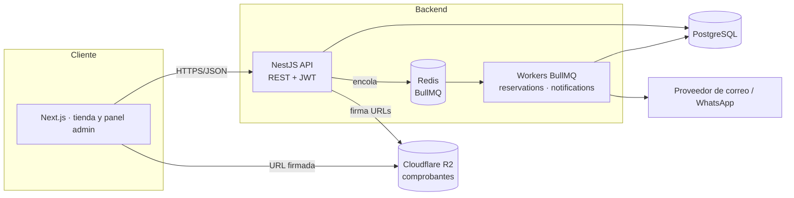
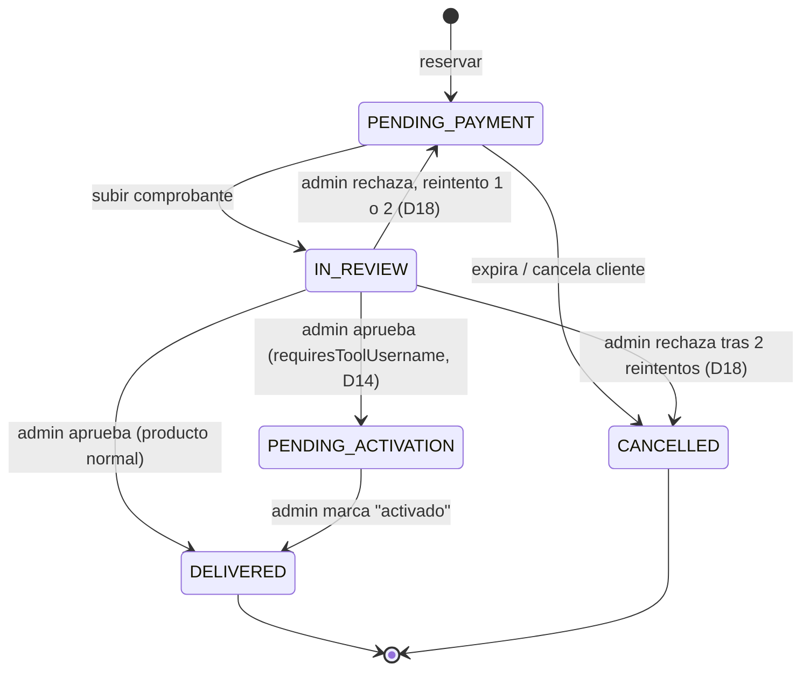
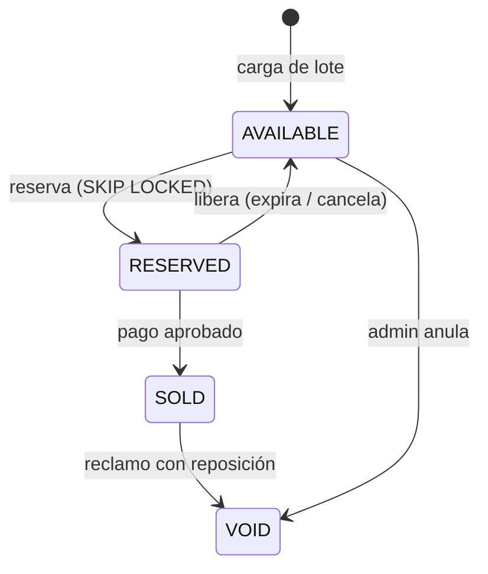
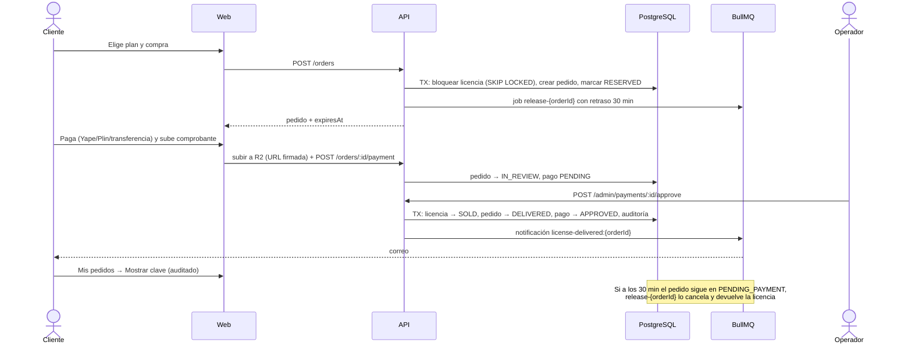

# 04 · Arquitectura

## Visión general

**Estado hoy:** `backend/` implementado (Sprint 1 — Fundaciones, ver `docs/backend/`). `frontend/` en scaffold.
R2 integrado (URLs firmadas de subida, módulo `storage`); correo y WhatsApp sin integrar.

## Stack
| Capa | Tecnología | Nota |
|---|---|---|
| API | NestJS 11 (TypeScript), REST | Módulos por dominio |
| ORM / BD | TypeORM 0.3 + PostgreSQL 16 | Migraciones versionadas |
| Colas | BullMQ + Redis 7 | Reservas y notificaciones |
| Auth | JWT (passport-jwt) + bcryptjs + roles | |
| Cifrado | AES-256-GCM (módulo `crypto` de Node) | |
| Web (por crear) | Next.js (App Router) + TypeScript | Tailwind + CSS Modules (D45) |
| Sesión web | NextAuth: credentials provider + **Google provider** contra la API | Reabre mecanismo de sesión del frontend (D46, D53); backend JWT no cambia. Google: `POST /auth/google` hace find-or-create por correo y marca `emailVerifiedAt` (D54) |
| Pruebas | Jest + Supertest | e2e contra Postgres/Redis reales |
| Local | Docker Compose (Postgres + Redis) | |
| Prod | Fly.io (API+workers, Redis) · Vercel (web) · Neon (Postgres) · R2 | D48, D49 — reemplaza Render/Upstash |

> **Versiones fijadas:** `@nestjs/config@4`, `@nestjs/jwt@11`, `@nestjs/passport@11`, `@nestjs/bullmq@11`, `@nestjs/typeorm@11`.
> Las v12 son solo ESM y rompen con Jest/CommonJS. Prisma se descartó en el entorno de desarrollo del Sprint 1 por descarga de motores bloqueada; **no es una decisión de producto**.

## Estructura del código (`backend/src`, verificada contra el código)
```
main.ts                  Bootstrap HTTP: helmet, CORS, ValidationPipe, pino, Swagger (no-prod), shutdown hooks
worker.ts                Bootstrap sin HTTP: createApplicationContext(WorkerModule)
app.module.ts             Raíz HTTP: CoreModule + Throttler + Health + Auth + Orders (+ Workers si APP_ROLE=all)
worker.module.ts          Raíz del proceso worker: CoreModule + WorkersModule
workers.module.ts         Agrupa los processors de BullMQ (orders + notifications)
configure-app.ts          Config HTTP compartida por main.ts y las pruebas e2e
swagger.ts                OpenAPI en /docs (fuera de producción)
core/
  config/                 EnvironmentVariables (class-validator), valida al arrancar
  redis/                  Cliente ioredis compartido (REDIS_CLIENT)
  core.module.ts           ConfigModule, pino, TypeOrmModule, BullModule, CryptoModule, AuditModule
common/
  crypto/                 CryptoService (AES-256-GCM + HMAC)
  decorators/             @Public, @Roles, @CurrentUser
  filters/                AllExceptionsFilter (formato de error único)
  types/                  AuthenticatedUser
database/
  entities/               19 entidades TypeORM + 2 @ViewEntity (v_plan_stock, v_sales_lines)
  views/                  Definición de las vistas
  enums.ts, currency.ts    Enums de dominio y monedas permitidas (PEN/USD)
  migrations/             InitialSchema (esquema) + DatabaseLogic (triggers/vistas/funciones)
  data-source*.ts         Config compartida app + CLI + pruebas
  run-migrations.ts        Entrypoint para `node dist/database/run-migrations.js` (Docker/Fly)
  seed.ts                  Admin + catálogo demo + métodos de pago + settings
auth/                     register/login/refresh/logout/me, JwtStrategy, guards, RefreshTokensService
users/                    UsersService (normaliza correo, búsquedas)
orders/                   OrdersService (reserva N ítems, cancelación), cola `orders`, processor, worker module
notifications/            Cola `notifications` idempotente (notification_logs), LogChannel
settings/                 SettingsService (lee `settings`, p. ej. TTL de reserva)
audit/                    AuditService (escribe en la transacción del llamador) + sanitizeMeta
health/                   /health, /health/ready (Postgres + Redis)
```
Módulos pendientes (Sprint 2+): `catalog`, `inventory`, `payments` (servicio/controlador — la entidad y el trigger
de moneda ya existen), `claims`, `admin`, `storage` (R2), `support` (tickets, D34), `reviews` (D33),
`reports` (diferido, D39/D55).

### Dos procesos, una imagen (D56/Fundaciones §2)
- **API** (`main.ts` → `AppModule`): HTTP, siempre corre. Importa `WorkersModule` (los processors de BullMQ)
  solo si `APP_ROLE=all` — por defecto en desarrollo.
- **Worker** (`worker.ts` → `WorkerModule`, `createApplicationContext`, sin HTTP): siempre importa
  `WorkersModule`, pensado para `APP_ROLE=worker` en producción.
- `APP_ROLE` (`api`\|`worker`\|`all`) se lee de la variable de entorno; si falta, `all` fuera de producción y `api`
  en producción. Permite correr todo en un solo proceso en desarrollo y separar API/worker en producción (Docker
  Compose perfil `app`, process groups `app`/`worker` de `fly.toml`) sin cambiar código de negocio.

## Máquinas de estado

### Pedido (`OrderStatus`)

### Licencia (`LicenseStatus`)

### Pago (`PaymentStatus`) y reclamo (`ClaimStatus`)
- Pago: `PENDING → APPROVED | REJECTED`.
- Reclamo: `OPEN → RESOLVED | REJECTED`.

| Evento | Pedido | Licencia | Pago |
|---|---|---|---|
| Reservar | → PENDING_PAYMENT | AVAILABLE → RESERVED (todas las líneas, D30) | — |
| Subir comprobante | → IN_REVIEW | — | crea PENDING |
| Aprobar (sin `requiresToolUsername`) | → DELIVERED | RESERVED → SOLD | → APPROVED |
| Aprobar (con `requiresToolUsername`) | → PENDING_ACTIVATION | RESERVED → SOLD | → APPROVED |
| Marcar activado | PENDING_ACTIVATION → DELIVERED | — | — |
| Rechazar (reintento 1–2) | → PENDING_PAYMENT | se mantiene RESERVED | → REJECTED, nuevo PENDING al reintentar |
| Rechazar (3.er intento) | → CANCELLED | RESERVED → AVAILABLE | → REJECTED |
| Expirar sin pago | → CANCELLED | RESERVED → AVAILABLE | — |

## Flujo principal


## Decisiones técnicas clave
1. **Reserva sin carreras:** `SELECT … FOR UPDATE SKIP LOCKED` dentro de una transacción. Cada comprador bloquea una licencia distinta o recibe 409.
2. **Liberación diferida + idempotente:** job `release-{orderId}`; el handler relee el estado con bloqueo de fila y solo actúa si sigue `PENDING_PAYMENT`.
3. **Red de seguridad:** job repetible `sweep-expired` cada 5 min (BullMQ `upsertJobScheduler`) libera lo vencido si Redis perdió algún job.
4. **PostgreSQL manda:** Redis solo coordina tiempos; perderlo no corrompe el negocio.
5. **Cifrado de claves** con AES-256-GCM; hash SHA-256 aparte para duplicados.
6. **Notificaciones idempotentes:** `jobId` único + fila en `notification_logs` (se reclama antes de enviar y se libera si el envío falla).

## Seguridad en capas
Red (HTTPS, CORS) → autenticación (JWT) → autorización (rol + propiedad) → validación (DTO whitelist) → datos (cifrado, transacciones, restricciones únicas) → auditoría.

## Despliegue (confirmado, D48/D49)
| Servicio | Plataforma | Variables clave |
|---|---|---|
| API + workers | Fly.io | `DATABASE_URL` (+`DB_SSL=true`), `REDIS_URL`, `JWT_SECRET`, `LICENSE_ENC_KEY`, `CORS_ORIGIN` |
| Redis | Fly.io (instancia propia) | sin límite de comandos; red privada con la API |
| Web | Vercel | URL de la API, secreto de NextAuth |
| BD | Neon | pooled connection recomendada |
| Archivos | Cloudflare R2 | credenciales S3-compatibles, bucket privado |

Despliegue: `npm run build` → `npm run migration:run` → `node dist/main`.

> **Pendiente de despliegue:** `npm run migration:run` usa `ts-node` (devDependency). En producción conviene ejecutar las
> migraciones con el JS compilado: `typeorm migration:run -d dist/database/data-source.js`, o instalar devDependencies en el paso de build.
