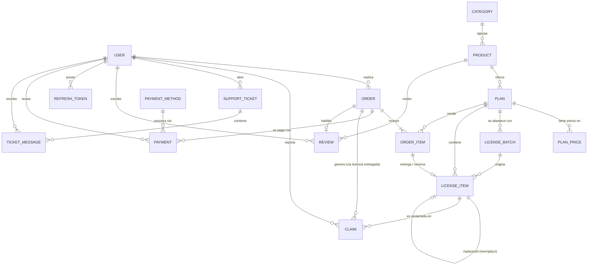

# 05 · Modelo de datos

Fuente de verdad: `backend/src/database/entities/*.ts` y `backend/src/database/migrations/`.
Convenciones: PK `uuid`; fechas `timestamptz`; dinero en **céntimos (int)**; enums nativos de PostgreSQL.
Detalle completo (columna por columna, verificado contra el código) en `docs/backend/database.md`.

Decisiones de esquema de esta sección provienen del brainstorming de Sprint 2–4 (`docs/09`, D14–D52) y del diseño
de Fundaciones (`docs/09`, D56–D65).



## Tablas

| Tabla | Propósito | Columnas relevantes |
|---|---|---|
| `users` | Cuentas | `email` único (minúsculas), `passwordHash` **nullable** (vacío en cuentas solo-Google), `googleId` **único, nullable** (D53), `name`, `role` (CUSTOMER/ADMIN), `phone`, `emailVerifiedAt` (auto si viene de Google, D54), `emailVerificationTokenHash` (SHA-256 hex, nullable, `select: false`), `emailVerificationExpiresAt` (nullable; token de un solo uso, RF-AUT-07/D74) |
| `categories` | Agrupación del catálogo | `name` único |
| `products` | Herramienta | `name`, `slug` único, `description`, `active`, `categoryId`, `requiresToolUsername` (bool, D14), `whatIncluded`/`compatibility`/`activationGuide` (text, nullable), `faq` (jsonb, nullable: `[{question, answer}]`) |
| `plans` | Variante comprable | `productId`, `name`, `kind` (NEW/RENEWAL), `durationDays`, `lowStockThreshold` (def. 5), `active` — **sin precio propio**: los precios viven en `plan_prices` (D61, reemplaza en parte a D51) |
| `plan_prices` | Precio de un plan en una moneda (D61) | `planId`, `currency` (`PEN`/`USD`), `priceCents` (`CHECK > 0`). Único `(planId, currency)`: un plan puede tener precio en PEN, en USD, en ambas o en ninguna (entonces no es comprable) |
| `license_batches` | Compra a proveedor | `planId`, `supplier`, `unitCostCents`, `costCurrency` (default `'USD'`, D62), `fxRatePen numeric(10,4)` (obligatorio y `>0` si `costCurrency='USD'`; `NULL` si `'PEN'`), `notes`, `purchasedAt` |
| `license_items` | **Una licencia vendible** | `planId`, `batchId`, `secretEncrypted`, `secretHash` **único**, `status`, `reservedUntil`, `orderItemId` **único entre activas** (ver índice parcial), `soldAt`, `replacesId` (nullable, D28) |
| `orders` | Pedido | `userId`, `orderNumber` (secuencia legible desde #1001), `status`, `totalCents`, `currency` (`PEN`/`USD`, sin default: la elige el cliente, D61), `toolUsername`, `expiresAt`, `cancelReason` |
| `order_items` | Línea de pedido (carrito, D30) | `orderId`, `planId`, `unitPriceCents` — sin columna `currency` propia, hereda la del pedido |
| `payment_methods` | Método de pago administrable (D63) | `code` **único**, `name`, `kind` (`WALLET`/`BANK_TRANSFER`/`CRYPTO`), `currencies char(3)[]` (subconjunto de `{PEN,USD}`; `CRYPTO` solo `{USD}`), `instructions` (jsonb, D65), `active`, `sortOrder` |
| `payments` | Comprobante y revisión | `orderId`, `paymentMethodId` (FK a `payment_methods`, reemplaza a `method`), `operationNumber`, `proofKey`, `proofHash` **único** (D21), `legalDeclarationAcceptedAt` (RF-COM-13/D72), `status`, `rejectionReason`, `reviewedById`, `reviewedAt`. Único **`(paymentMethodId, operationNumber)`**, normalizado sin espacios y en minúsculas (D64: el mismo número en métodos distintos no choca) |
| `refresh_tokens` | Refresh token opaco rotativo (D56) | `userId`, `tokenHash` **único** (HMAC, nunca el valor en claro), `familyId`, `expiresAt`, `revokedAt` (nullable), `revokedReason` (`ROTATED`/`LOGOUT`/`REUSE_DETECTED`, nullable), `replacedById` (nullable). Índice `(familyId)` |
| `claims` | Reclamo de clave inválida | `orderId` (FK, agregada para el índice único "un reclamo `OPEN` por pedido"), `licenseItemId`, `userId`, `reason`, `status`, `replacementLicenseId`, `resolvedById`, `resolvedAt` |
| `support_tickets` | Ticket de soporte general (D34) | `userId`, `subject`, `status` (OPEN/CLOSED), `createdAt` |
| `ticket_messages` | Mensaje dentro de un ticket (D34) | `ticketId`, `authorId`, `body`, `isAdmin` (bool), `createdAt` |
| `reviews` | Reseña de producto (D33) | `productId`, `userId`, `orderId`, `rating` (1–5), `body`, `status` (PENDING/APPROVED/HIDDEN), `createdAt` |
| `settings` | Configuración clave/valor (TTL, horario, SLA, monto máx. cliente nuevo) | `key` **único**, `value` (jsonb) |
| `audit_logs` | Quién hizo qué | `actorId`, `action`, `entity`, `entityId`, `meta` (jsonb) |
| `notification_logs` | Idempotencia de envíos | `key` **único**, `channel`, `recipient`, `template` |

## Índices y restricciones que sostienen las reglas de negocio
- `license_items(planId, status)` → contar y bloquear stock disponible rápido.
- `license_items.secretHash` único → no se puede cargar dos veces la misma clave.
- `license_items.orderItemId`: índice **único parcial** `WHERE status IN ('RESERVED','SOLD')` → una línea de pedido activa tiene, como máximo, una licencia activa; una licencia `VOID` por reposición conserva su `orderItemId` histórico sin bloquear al reemplazo (D28).
- `payments.operationNumber` único, `payments.proofHash` único → bloqueo automático de comprobantes reutilizados (D21).
- `payments.status` único activo por pedido (a lo sumo un `PENDING` por `orderId`).
- `orders(status, expiresAt)` → el barrido localiza reservas vencidas sin escanear todo.
- `orders.orderNumber` único, autoincremental legible (p. ej. `#1042`).
- `claims`: índice único parcial `WHERE status='OPEN'` por `orderId` → invariante 6.
- `payments(status)`, `claims(status)`, `support_tickets(status)` → colas del panel admin.
- `audit_logs(entity, entityId)` → historial de cualquier objeto.
- `settings.key` único.

## Invariantes (deben cumplirse siempre; hay o debe haber prueba)
1. Una licencia `RESERVED`/`SOLD` tiene `orderItemId`; una `AVAILABLE` no lo tiene.
2. Una licencia `AVAILABLE` no tiene `reservedUntil`.
3. Un pedido `DELIVERED` tiene todas sus licencias en `SOLD` y su pago en `APPROVED`.
4. Un pedido `IN_REVIEW` mantiene sus licencias reservadas (no se libera por expiración).
5. `totalCents` = suma de `unitPriceCents` de sus líneas (precio congelado al comprar; cambios de precio no afectan pedidos existentes).
6. Nunca hay dos reclamos `OPEN` sobre el mismo pedido.
7. Toda licencia de reemplazo (`replacesId` no nulo) apunta a una licencia `VOID` por reclamo resuelto; la original nunca se reutiliza.
8. Todas las líneas (`order_items`) de un mismo pedido comparten la misma `currency` que el pedido.
9. Un producto con `requiresToolUsername = true` exige `orders.toolUsername` no nulo antes de pasar a `IN_REVIEW`.
10. Todo `user` tiene `passwordHash` **o** `googleId` (nunca ambos nulos).

## Cálculo de estado de stock (catálogo)
```
disponibles = COUNT(license_items WHERE planId = :id AND status = 'AVAILABLE')
estado = disponibles = 0 ? 'Agotado' : disponibles <= plan.lowStockThreshold ? 'Pocas unidades' : 'En stock'
```
El catálogo público solo expone `estado` (D29), nunca `disponibles`. Implementado en Postgres como la vista
`v_plan_stock` (ver abajo), no como una consulta repetida en cada servicio.

**Margen por venta (D62)**, en la moneda de la venta (vista `v_sales_lines`):
- Venta y costo en la misma moneda → `unitPriceCents − unitCostCents`.
- Venta en `PEN` con costo en `USD` → `unitPriceCents − ROUND(unitCostCents × fxRatePen)` (el lote guarda cuántos
  soles costó realmente cada dólar/USDT que pagó Joseph, D62).
- Venta en `USD` con costo en `PEN` → `NULL` (un lote en soles no guarda tasa; caso marginal porque Joseph compra en USDT).

## Lógica en base de datos (D57)

Defensa en profundidad además de la lógica en NestJS: triggers, vistas y funciones viven en la migración
`DatabaseLogic` (`backend/src/database/migrations/*-DatabaseLogic.ts`). Detalle completo en
`docs/backend/database.md`; resumen:

- **Triggers**: `trg_set_updated_at` (mantiene `updatedAt`); `trg_license_status_guard` y `trg_order_status_guard`
  (rechazan con `ERRCODE='P0001'` cualquier transición de estado fuera de las permitidas, invariantes 1 y de
  máquina de estados); `trg_order_total_check`/`trg_order_items_total_check` (constraint trigger diferido: al
  `COMMIT` verifica que `totalCents` cuadre con la suma de líneas, invariante 5); `trg_audit_logs_immutable`
  (bloquea `UPDATE`/`DELETE` en `audit_logs`); `trg_payment_method_currency` (el método de pago debe estar activo
  y aceptar la moneda del pedido, D63).
- **Vistas** (solo lectura, ninguna expone `secretEncrypted`/`secretHash`): `v_plan_stock` (stock agregado por
  plan, usa `lowStockThreshold`) y `v_sales_lines` (una fila por licencia vendida, con el margen ya calculado
  según la fórmula de arriba).
- **Funciones**: `fn_release_order(orderId, reason, requireExpired)` (libera un pedido `PENDING_PAYMENT`, único
  camino para el job de liberación, el barrido y la cancelación del cliente) y `fn_release_expired()` (recorre los
  pedidos vencidos con `SKIP LOCKED` y llama a la anterior sobre cada uno). `fn_approve_payment(paymentId, adminId)`
  (licencia → `SOLD`, pedido → `DELIVERED`, pago → `APPROVED`; idempotente si ya estaba `APPROVED`) y
  `fn_reject_payment(paymentId, adminId, reason, extraMinutes)` (pago → `REJECTED`; al 3.er rechazo del pedido
  libera la licencia y cancela, si no vuelve a `PENDING_PAYMENT` con plazo extra, D18), migración
  `AdminPaymentFunctions`.

Un cambio a estas reglas de estado exige una migración nueva (nunca editar una ya aplicada).

## Pendiente deliberadamente (no implementar aún)
- `license_items.keyVersion` (rotación de llave de cifrado) — diferido, D50.
- Separación de roles ADMIN/OWNER — diferido, D35.
