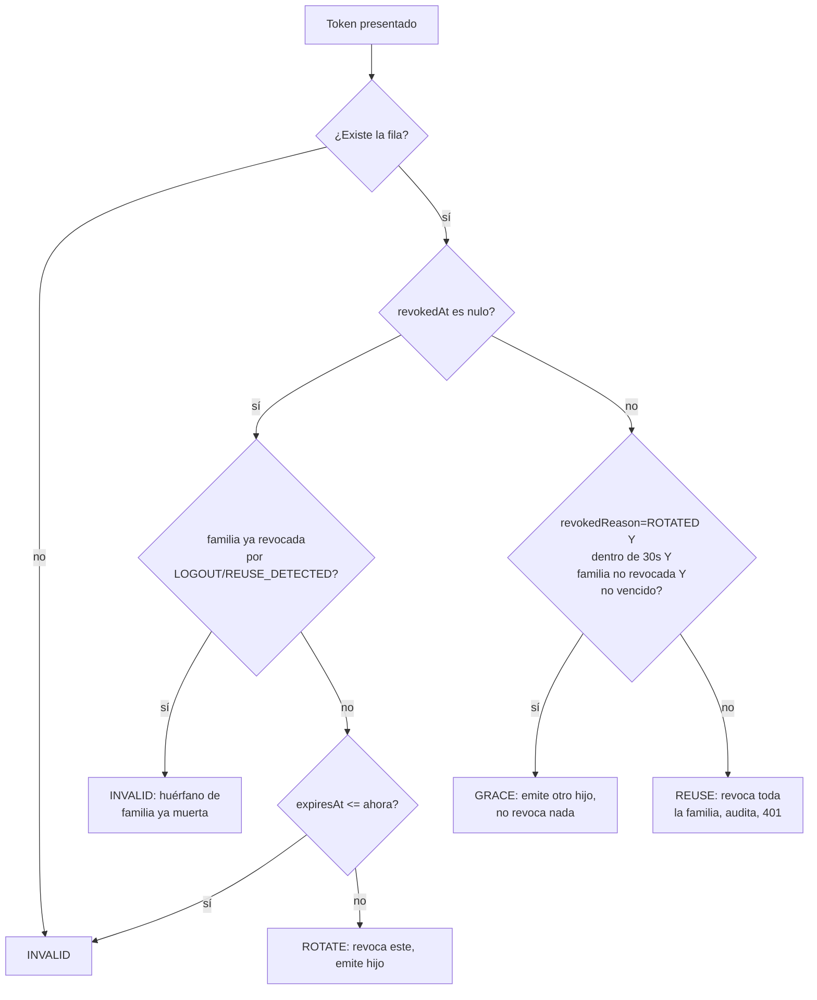

# Auth

**Archivos:** `src/auth/auth.controller.ts`, `src/auth/auth.service.ts`, `src/auth/refresh-tokens.service.ts`,
`src/auth/refresh-policy.ts`, `src/auth/jwt.strategy.ts`, `src/auth/guards/*.ts`, `src/auth/dto/*.ts`,
`src/common/decorators/*.ts`. Pruebas: `src/auth/refresh-policy.spec.ts` (unitaria, función pura `decideRefresh`),
`test/auth.e2e-spec.ts`.

## Endpoints

| Método y ruta | Acceso | Body | Respuesta | Errores |
|---|---|---|---|---|
| `POST /auth/register` | 🌐 público (rate limit 3/min) | `{email, password, name?}` | `201 {accessToken, refreshToken, user}` | `400` si `role` llega en el body (whitelist) o falla alguna validación de DTO; `409 "Ya existe una cuenta con ese correo"` |
| `POST /auth/login` | 🌐 público (rate limit 5/min) | `{email, password}` | `200 {accessToken, refreshToken, user}` | `401 "Correo o contraseña incorrectos"` — mismo mensaje exista o no el correo (compara contra un hash *dummy* para igualar el tiempo de respuesta) |
| `POST /auth/refresh` | 🌐 público (rate limit 10/min) | `{refreshToken}` | `200 {accessToken, refreshToken}` | `401 "Sesión inválida, vuelve a iniciar sesión"` si el token no existe, venció, o se detecta reuso |
| `POST /auth/logout` | 👤 autenticado | `{refreshToken}` | `204` sin cuerpo | — (si el token no es del usuario o no existe, no hace nada y responde `204` igual) |
| `GET /auth/me` | 👤 autenticado | — | `200 {id, email, name, role, phone, emailVerifiedAt}` | `401` si el usuario del JWT ya no existe |

`register`/`login` responden `200`/`201` con `AuthResponseDto` (`accessToken`, `refreshToken`, `user: UserDto`).
`UserDto` nunca incluye `passwordHash` ni `googleId` (`src/auth/dto/auth-response.dto.ts`).

DTOs (`class-validator`, mensajes en español):
- `RegisterDto`: `email` (recortado, formato válido, máx. 254), `password` (8–72 caracteres), `name?` (máx. 80).
- `LoginDto`: `email` (recortado, formato válido), `password` (no vacío, máx. 72).
- `RefreshDto`: `refreshToken` (string no vacío, máx. 200).

## Tokens

- **Access**: JWT HS256, firmado con `JWT_SECRET`, expira en **15 min** (`signOptions: { expiresIn: '15m' }` en
  `AuthModule`). Payload `{sub, role}`.
- **Refresh**: 64 bytes aleatorios en base64url (`randomBytes(64)`), vigencia **30 días**
  (`REFRESH_TTL_MS = 30 * 24 * 60 * 60 * 1000`). Solo se guarda su hash: `tokenHash = HMAC-SHA256(JWT_REFRESH_PEPPER, raw)`,
  nunca el valor en claro.
- Contraseñas: `bcryptjs`, cost **12**.

### Rotación, ventana de gracia y detección de reuso

`RefreshTokensService.rotate()` corre dentro de una transacción Postgres. Primero toma
`pg_advisory_xact_lock(hashtextextended(familyId, 0))` para serializar **toda** rotación, logout (`revokeFamily`) o
barrido de reuso de la misma familia (ver el comentario en el archivo: sin este mutex, bajo `READ COMMITTED` una fila
hija recién insertada por una rotación legítima concurrente podía quedar invisible para el `UPDATE` masivo que
revoca la familia por reuso o por logout). `revokeFamily` toma el mismo lock, con la misma derivación de la clave,
antes de su propio `UPDATE` masivo — por eso un logout no puede dejar vivo el hijo de una rotación concurrente.
Luego `rotate()` bloquea la fila del token con `FOR UPDATE` y decide con `decideRefresh` (función pura,
`src/auth/refresh-policy.ts`):

- **ROTATE**: el token estaba vigente y sin revocar. Se marca `revokedAt = now()`, `revokedReason = ROTATED`, se
  crea un token hijo en la misma familia (`replacedById`) y se devuelve el par nuevo.
- **GRACE** (ventana de **30 s**, `REFRESH_GRACE_MS`): si el token ya fue rotado hace menos de 30 s, la familia no
  tiene revocaciones por `LOGOUT`/`REUSE_DETECTED` y no venció, se emite otro token hijo de la misma familia **sin
  revocar nada**. Cubre varias pestañas o requests paralelos que refrescan con el mismo token: el `FOR UPDATE`
  serializa los refresh simultáneos, el primero rota y el resto entra por la ventana de gracia.
- **REUSE**: cualquier otro caso de token revocado (fuera de la ventana, o revocado por `LOGOUT`/`REUSE_DETECTED`).
  Se revocan con `UPDATE` todos los tokens activos (`revokedAt IS NULL`) de la familia con
  `revokedReason = REUSE_DETECTED`, se audita `auth.refresh_reuse_detected` (`meta: {familyId}`) y se responde `401`.
- **INVALID**: el token no existe, venció sin haber sido revocado, o es un **huérfano**: su propia fila nunca se
  marcó revocada pero su familia ya fue matada por `LOGOUT`/`REUSE_DETECTED` (p. ej. el hijo de una rotación
  legítima que ganó la carrera de commit contra un logout/reuso concurrente de la misma familia) → `401` sin tocar
  la base (la familia ya está revocada).

`revokeFamily` (logout): toma el mismo `pg_advisory_xact_lock` por familia que `rotate()` antes de revocar con
`LOGOUT` todos los tokens activos de la familia del token presentado, solo si pertenece al `userId` dado. Sin este
lock, el `UPDATE` masivo de logout corre la misma carrera que el de reuso: puede no ver el token hijo que una
rotación legítima concurrente está insertando.

## Guards y decoradores

- `JwtAuthGuard` (extiende `AuthGuard('jwt')`) es **global** (`APP_GUARD` en `app.module.ts`): toda ruta exige un
  JWT válido en `Authorization: Bearer <token>` salvo las marcadas `@Public()`. Sin token o inválido → `401 "Debes iniciar sesión"`.
- `RolesGuard` también es **global**. Sin `@Roles(...)` en la ruta, deja pasar. Con `@Roles('ADMIN')`, exige que
  `user.role` esté en la lista o responde `403 "No tienes permiso para esta acción"`.
- Orden de guards (comentado en `app.module.ts`): **rate limit → sesión → rol**.
- `@CurrentUser()` inyecta `{id, role}` (tipo `AuthenticatedUser`) desde el `request.user` que deja `JwtStrategy.validate`.
- La propiedad del recurso (invariante 7: un cliente nunca ve pedidos ajenos) se verifica en los servicios, no en un
  guard: las consultas filtran por `userId` y un recurso ajeno responde `404` (ver `orders.md`).

## Rate limiting

`@nestjs/throttler` con almacenamiento en Redis (`ThrottlerStorageRedisService`, comparte contador entre instancias).
- Global: **100/min** por IP (`ThrottlerModule.forRootAsync` en `app.module.ts`).
- `POST /auth/register`: **3/min**.
- `POST /auth/login`: **5/min**.
- `POST /auth/refresh`: **10/min**.
- Mensaje al superar cualquier límite: `429 "Demasiados intentos, espera un momento"`.
- `GET /health` y `GET /health/ready` tienen `@SkipThrottle()`.
- `THROTTLE_ENABLED=false` desactiva el guard por completo (lo usan las pruebas que no verifican rate limit).

## Auditoría

- `auth.login_failed`: `meta: {email}` normalizado, en cualquier fallo de login (correo inexistente o contraseña
  incorrecta — mismo evento para ambos).
- `auth.refresh_reuse_detected`: `meta: {familyId}`, al detectar reuso de un refresh token.
